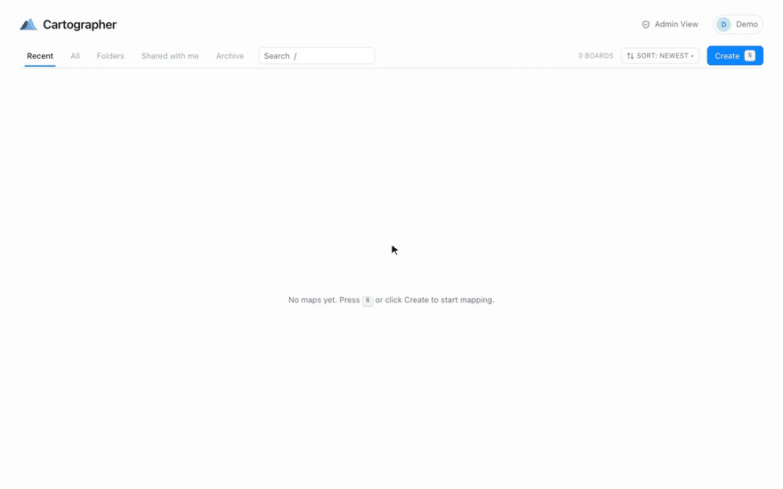

<div align="center">

# Cartographer

**A self-hosted canvas for mapping how things fit together, where every node is a markdown file
you own, and your AI agents can draw on it too.**

[](LICENSE)




</div>

Cartographer is a visual thinking tool for systems, products, research and anything else that
is easier to understand as a picture. Lay ideas out on a freeform map, or let them arrange
themselves as a living graph. Open any node to write real notes and keep structured data next to
them. Behind the canvas there is no proprietary database, just a folder of markdown files you can
open in any editor, back up with `cp`, and version with `git`.

## Why Cartographer

- **Your files, not ours.** Every node is a `node.md` on disk, with an optional `data.json` beside
  it. The canvas is a view over plain text, so your maps outlive the app.
- **Two ways to think.** A **map** is a freeform canvas you arrange by hand. A **graph** lays
  itself out from the links between ideas. Use whichever suits the problem, and nest one inside
  the other.
- **Built for agents.** A built-in MCP server lets Claude, Codex or any MCP client read your
  boards and build new ones. They can create and refine; only people can delete and share.
- **Yours to run.** One Docker container, one volume, no external requests at runtime. Accounts,
  private workspaces and view-only sharing are included, so a team can share one instance.

## Features

### Maps: a freeform canvas
- **Cards and chips.** A full card with title, description and status, or a compact pill; press
  `C` to switch.
- **Five shapes, a colour palette and statuses** that you can extend without a rebuild.
- **Frames** group related nodes into tinted sections. Each frame shows a live status strip and
  can collapse, and you can promote one into its own sub-map in one step.
- **Connectors** can be solid or dashed (for tentative links), labelled, and routed at right
  angles with draggable bends.
- **Free text labels** in three sizes for headings and annotations.
- **Drag from a node's edge** onto empty canvas to create the next node, already linked, so you
  can sketch a whole flow without breaking stride.

### Graphs: let the structure emerge
- **A force-directed layout** where related ideas pull together. You can tune repulsion, link
  distance and centring live.
- **`[[Wiki-links]]` in notes become edges.** Write about a node and the graph draws the link
  for you, alongside the edges you draw by hand.
- **Ghost nodes** stand for things you have mentioned but not created yet. Click one and it
  becomes real.
- **Filter, and colour by colour, status or tag**, to see clusters, gaps and orphans at a glance.

### Nodes that hold real content
- **Markdown notes** with a formatting toolbar and a live preview.
- **Data snippets**: labelled code or data blocks in any language, kept in the node's sidecar
  file.
- **Data flows along edges.** Mark one snippet as a node's output and it shows up as an input on
  every node downstream. Inputs are computed from the graph, so they never go stale.
- **Backlinks and links out** for every node, so you can trace what refers to what.
- **Sub-boards.** Any node can open into one or more child maps or graphs, nested as deep as you
  like, with a breadcrumb back up.

### Made for AI agents
- **A built-in MCP server** at `/mcp`, on the same port and behind the same login as the app.
- **Twenty-six tools.** Agents can list, read, search and export boards; create boards, nodes,
  notes, links, frames and labels; lay out and restyle their work; and file boards into folders.
- **Safe by design.** No tool archives, deletes or shares anything. An agent's first write to a
  board snapshots it, so any run is one restore away from undone.
- **You can see what agents made.** Their cards wear a small bot glyph that names the token and
  date.
- **Live updates.** A board you have open updates itself as an agent writes to it, with no reload.
- **One-click setup.** Generate a personal access token (read-only or read & write) and copy a
  ready-made config for Claude Code, Claude Desktop, Codex or any MCP client.

### Organise everything
- **A dashboard** with Recent, All, Folders, Shared with me and Archive tabs.
- **Folders and favourites.** Folders are labels, not locations, so filing a board moves nothing
  on disk.
- **Search and sort** across every board, plus bulk actions on a multi-selection.
- **A command palette** (`Ctrl/⌘ K`) that jumps to any board or node by name.
- **Walkthroughs.** Step through a board node by node, following its edges and choosing a path at
  each branch.
- **Export** a board or a selection as clean markdown, ready for a doc or an LLM prompt.

### Work together, safely
- **Accounts with private workspaces.** Each person's boards are theirs alone, enforced at the
  file-path level.
- **View-only sharing** of any board with another account.
- **A cross-board clipboard.** Copy nodes between your boards, and even between a map and a graph.
- **An admin view** to create accounts, reset passwords, disable or enable access and browse
  anyone's boards read-only. Every admin action is recorded in an audit log.
- **Nothing is ever lost.** Deleting means archiving, and archived boards restore with one click.
  Undo and redo cover canvas edits, and snapshots capture a whole board.
- **No silent overwrites.** If someone else's change arrives while you are editing, the next save
  is refused with a warning rather than quietly discarding their work.

### Keyboard-first
Nearly everything has a shortcut: `N` for a new node, `S` to cycle status, `1`–`5` for shapes,
`F` to frame a selection, `E` to open a sub-map, `Ctrl/⌘ D` to duplicate, `Ctrl/⌘ E` to export.
The [guide](docs/GUIDE.md#keyboard) has the full list.

## What people map with it

- **Software architecture**: modules, data flow and the files behind them. The starter boards
  map Cartographer itself this way.
- **Product outlines**: features grouped into frames, each with a status, so progress shows at a
  glance.
- **Knowledge graphs**: research notes linked with `[[wiki-links]]`, so the structure emerges on
  its own.
- **Pipelines and processes**: steps that pass data to each other, with the actual payloads kept
  on the nodes.
- **Agent workspaces**: a shared surface where an agent lays out what it found and you refine it.

Every new account starts with a **Cartographer Docs** folder: the app explained as real boards
you can open, edit and take apart.

## Your data is just files

```
data/
├── app.db                       # accounts, sessions, shares, tokens (no content)
├── config.json                  # optional: your own statuses, shapes and colours
└── users/<user-id>/
    ├── boards/<board-id>/
    │   ├── board.json           # layout: positions, edges, frames, labels
    │   └── nodes/<node-id>/
    │       ├── node.md          # the node's notes, with frontmatter
    │       └── data.json        # optional structured snippets
    ├── archive/                 # everything "deleted"; restore with a click or `mv`
    ├── deleted/                 # deleted from the archive; only an admin can empty it
    ├── snapshots/               # full copies of boards at a point in time
    └── folders.json             # your folders and favourites
```

Layout lives in `board.json` and meaning lives in the markdown, so a node file makes sense on its
own in any editor. The database stores only accounts and permissions; delete it and every map
survives.

## Quick start

You need Docker.

```bash
cp .env.example .env      # set ADMIN_PASSWORD
docker compose up -d --build
```

Cartographer listens on port **56321**, bound to `127.0.0.1`. It speaks plain http, so put a
reverse proxy in front of it to terminate TLS. Sign in as `admin` with the password you set; you
will be asked to choose a new one straight away. Your data lives in the `cartographer-data`
volume.

To develop locally instead, with Node 22 or newer:

```bash
npm install
cp .env.example .env   # set ADMIN_PASSWORD
npm run dev            # http://localhost:5173
```

## Connect an agent

1. Open the profile menu and choose **API & Agents**.
2. Generate a token: read-only, or read & write.
3. Copy the config for your client. For Claude Code it looks like this:

```bash
claude mcp add --transport http cartographer \
  https://your-host/mcp \
  --header "Authorization: Bearer <your token>"
```

Then ask your agent to map something, such as a codebase, a plan or a paper, and watch the board
fill in.

## Make it yours

Drop a `config.json` into the data volume to add statuses, shapes or colours without rebuilding
([every option](docs/CONFIGURATION.md#configjson)):

```json
{
  "statuses": [
    { "id": "sketched", "label": "Sketched", "colorToken": "--status-sketched" },
    { "id": "built", "label": "Built", "colorToken": "--status-built" },
    { "id": "verified", "label": "Verified", "colorToken": "--status-built" }
  ]
}
```

Under the hood, each board type is a self-contained module registered in one place, and every
server feature lives in its own folder. Adding something new, such as another board type or an
integration, means adding a module rather than editing code across the app.

## Documentation

| | |
|---|---|
| [Guide](docs/GUIDE.md) | Running, accounts, agents, storage, keyboard, canvas elements, configuration |
| [Configuration](docs/CONFIGURATION.md) | Every environment variable, Docker option and `config.json` setting |
| [Operations](docs/OPERATIONS.md) | Deployment, backups, recovery, testing |
| [Architecture](docs/ARCHITECTURE.md) | How the code is laid out and how a request flows |
| [Conventions](docs/CONVENTIONS.md) | The rules the codebase holds itself to |
| [Decisions](docs/DECISIONS.md) | Why things are the way they are |
| [Known issues](docs/KNOWN-ISSUES.md) | Open defects |

Built with React, React Flow, CodeMirror, Fastify and SQLite, in TypeScript.

## Contributing

Issues and pull requests are welcome. See [CONTRIBUTING.md](CONTRIBUTING.md) for setup and the
checks a change has to pass, and [SECURITY.md](SECURITY.md) for reporting vulnerabilities
privately.

## License

Copyright 2026 Nikto655. Cartographer is free software, licensed under the
[GNU Affero General Public License v3.0](LICENSE) (AGPL-3.0-only).

You may use, study, modify and share it for any purpose, including commercially. If you modify
it and let other people use your modified version over a network, for example by hosting it for
them, you must offer those users the complete source of your version under the same license.
Running an unmodified copy, or a modified copy only for yourself, carries no such obligation.

The name "Cartographer" and the logo are trademarks, and the license does not cover them
(AGPL section 7(e)). Forks that are shared or hosted need their own name and logo; see
[TRADEMARKS.md](TRADEMARKS.md) for what is allowed without asking.
